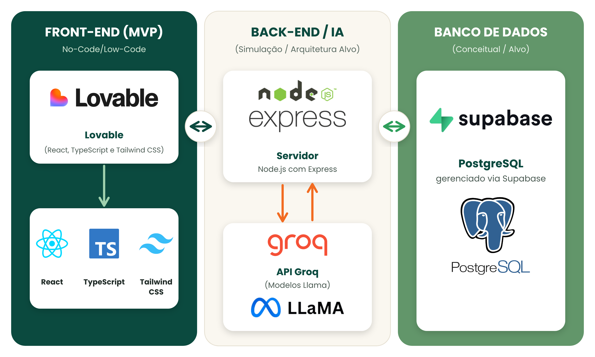

# Diagrama

Atualmente, o **EcoTravel** opera com foco na interface responsiva e *mobile-first* (construída em **React, TypeScript e Tailwind CSS** via Lovable). Para a evolução da plataforma em produto completo e aplicativo, a arquitetura alvo integra persistência de dados, APIs e inteligência artificial generativa:

### Diagrama de Arquitetura Preliminar

### Camadas da Arquitetura

- **Front-end (MVP Atual & Evolução Mobile):** Interface responsiva em **React, TypeScript e Tailwind CSS** responsável pela coleta de preferências, exibição de roteiros, calculadora ambiental e painéis de gestão.
- **Back-end (Arquitetura Alvo):** Servidor de aplicação em **Node.js com Express.js** para exposição de endpoints REST (HTTP/JSON), autenticação e autorização de usuários, regras de negócio e orquestração das chamadas do assistente.
- **Banco de Dados (Arquitetura Alvo):** **PostgreSQL** (gerenciado via **Supabase**) para armazenamento relacional de usuários e perfis, destinos sustentáveis, hospedagens, trilhas, transportes e roteiros gerados.
- **Componente de IA (Arquitetura Alvo):** Integração via JSON com a **API Groq** utilizando modelos **Llama** para processamento de linguagem natural e recomendação personalizada.
