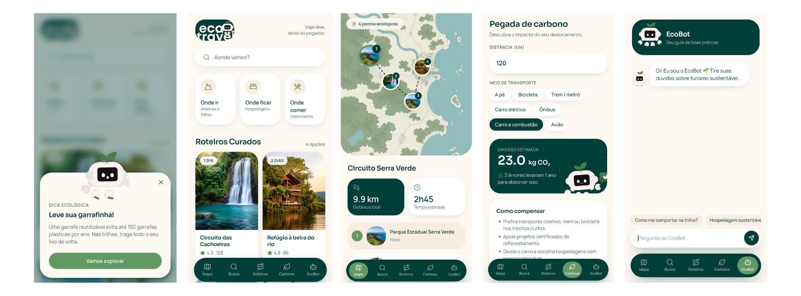

## Protótipo

A primeira versão funcional do **EcoTravel** foi gerada no **Lovable** a partir de apenas **2 prompts estruturados**, validando a identidade visual do layout, o mascote **EcoBot** e a proposta:

 **Prompt 1 — Identidade Visual, Escopo Educativo e Fluxo Mobile-First:**
  > *"Crie um aplicativo web mobile-first de ecoturismo sustentável chamado 'EcoTravel'. O layout deve ser construído rigorosamente em formato de aplicativo de celular (...), seguindo um padrão visual minimalista, elegante e de alto padrão (...). O app é estritamente informativo, educativo e focado em recomendações de roteiros, passeios ecológicos, pontos de interesse, transportes limpos, hospedagens e gastronomia sustentável."*

 **Prompt 2 — Responsividade Multiplataforma, Destinos Reais e Gamificação Verde:**
  > *"Atualize e expanda o aplicativo web multiplataforma 'EcoTravel' (...). O aplicativo precisa ser totalmente responsivo, adaptando-se com fluidez tanto para telas de computadores/notebooks quanto para dispositivos móveis (...). Utilizar exemplos e informações reais de ecoturismo no litoral paulista (...). Adicionar uma tela/aba de 'Créditos Verdes & Conquistas', onde o progresso ambiental do usuário é exibido."*
